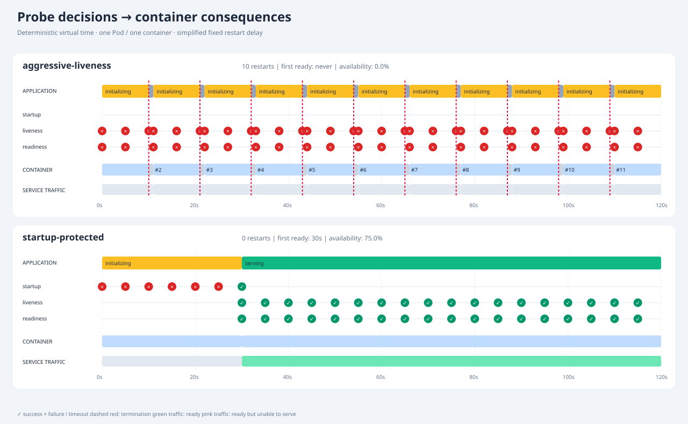

# kube-probe-restart-loop

A deterministic Go simulator showing how Kubernetes startup, liveness, and readiness
probe configurations affect a single application container. No cluster, Docker,
network checks, or wall-clock waiting is required.

An application that takes 30 seconds to initialize can be restarted every 11 seconds
by aggressive liveness checks. The same application, protected by a startup probe,
becomes ready at 30 seconds with no restarts.

## Quick start

Requires Go 1.26 or later. Run from the repository root:

```sh
go run ./cmd/kube-probe-restart-loop compare examples/slow-start.yaml --out artifacts/slow-start
```

Open `artifacts/slow-start/timeline.svg` in a browser. The report contains aligned
application, probe-result, container lifecycle, and Service traffic rows for both
configurations. Hover over results, response spans, and termination lines for causes.

| 120-second simulation | Restarts | First ready | Service availability |
| --- | ---: | --- | ---: |
| Aggressive liveness | 10 | never | 0% |
| Startup protected | 0 | 30s | 75% |



Run one variant or build a standalone executable:

```sh
go run ./cmd/kube-probe-restart-loop run examples/slow-start.yaml --variant startup-protected --out artifacts/protected
go build -o artifacts/kube-probe-restart-loop ./cmd/kube-probe-restart-loop
```

On Windows, use `-o artifacts/kube-probe-restart-loop.exe` for a named executable.
Place the scenario path before flags. `run` defaults to the first variant;
`compare` runs all variants in file order. Use distinct output directories to
retain reports; existing report files in the selected directory are overwritten.

## Examples

| File | What to inspect |
| --- | --- |
| [slow-start.yaml](examples/slow-start.yaml) | Repeated initialization interruption versus startup protection |
| [startup-budget.yaml](examples/startup-budget.yaml) | A startup probe with an insufficient failure budget also causes restarts |
| [overload.yaml](examples/overload.yaml) | Readiness withdraws traffic during overload, then recovers without restarts |
| [overload-liveness.yaml](examples/overload-liveness.yaml) | Wiring overload to liveness adds unnecessary restarts |
| [slow-endpoint.yaml](examples/slow-endpoint.yaml) | Timeout shorter than response latency creates false failures |
| [flapping.yaml](examples/flapping.yaml) | Thresholds trade fast withdrawal against stability and recovery delay |

## Authoring scenarios

The simulator uses its own YAML format, not a Kubernetes Pod manifest:

```yaml
name: Temporary pressure
duration: 90s
restartDelay: 1s
terminationDelay: 0s
application:
  startupDuration: 10s
  responseLatency: 50ms
  windows:
    - from: 30s
      to: 45s
      clock: scenario
      state: overloaded
      canServe: false
      responses:
        readiness: {success: false, latency: 50ms}
variants:
  - name: protected
    probes:
      startup: {periodSeconds: 2, failureThreshold: 10}
      liveness: {periodSeconds: 5}
      readiness: {periodSeconds: 2, failureThreshold: 1, successThreshold: 2}
```

Application and lifecycle settings are shared by all variants; each variant supplies
its complete probe configuration. An omitted probe is disabled. An empty probe
mapping (`readiness: {}`) enables it with Kubernetes field defaults:

| Field | Default | Accepted values |
| --- | ---: | --- |
| `initialDelaySeconds` | 0 | 0–86400 |
| `periodSeconds` | 10 | 1–86400 |
| `timeoutSeconds` | 1 | 1–86400 |
| `failureThreshold` | 3 | 1–100000 |
| `successThreshold` | 1 | 1–100000 for readiness; exactly 1 for startup/liveness |

Durations use Go notation (`500ms`, `30s`, `2m`). Scenario duration must be positive
and at most 24 hours. Restart delay defaults to 1s and must be at least 1ms;
termination delay defaults to zero. Application duration fields default to zero.

Before initialization completes, the application cannot serve and all default probe
responses fail. Afterwards it can serve and default responses succeed. Windows
override state labels, serving ability, and individual probe responses independently.
A label such as `overloaded` has no hidden behavior: set `canServe` and responses
explicitly. A response mapping with omitted `success` means failure, and omitted
`latency` means zero latency. Unspecified probe responses retain application defaults.

`clock: scenario` uses global simulation time (external overload survives restarts).
`clock: container` uses the age of each container instance (faults repeat after
restarts). Windows are half-open `[from, to)`; later matching windows override earlier
ones field by field. They cannot make an uninitialized application serve, but can
make its probes report success to demonstrate misleading health endpoints.

Unknown fields, duplicate YAML keys, invalid values, extra YAML documents, and
duplicate or unsafe variant names are rejected.

## Reports and measurements

Every command writes `summary.txt`, `events.json`, and `timeline.svg`.
JSON contains the resolved configuration, causal event log, state intervals, and
metrics for each selected variant. JSON durations are integer nanoseconds; summary
and SVG times are human-readable. Outputs contain no current timestamps or randomness.

| Metric | Meaning |
| --- | --- |
| Restarts | Container starts after the initial start; pending restarts at the horizon do not count |
| First ready | Time since simulation start; `never` / JSON `null` if unreached |
| Unavailable | Total time ineligible for normal Service traffic |
| Ready but unable to serve | Time readiness allows traffic while the app cannot serve |
| Failed probes | Completed failures by probe type, including the timeout subset |
| Restarts per minute | Restart count divided by observation duration in minutes |
| Simulated service availability | Fraction of observation time both ready and actually able to serve |

Availability assumes continuous demand. It is not a measured request success rate.
Readiness can report success incorrectly; keeping that separate from actual serving
ability makes false availability visible.

## Model and validation

This is an educational state-machine model, with fixed scheduling and restart delays,
not a kubelet emulator. It assumes `restartPolicy: Always`, instantaneous Service
routing changes, and one container with no additional Pod readiness gates.
It does not emulate Kubernetes backoff, accelerated readiness probing, networking,
transport-specific health checks, image pulls, scheduling, or termination hooks.

See [the simulation contract](docs/SIMULATION.md) for timing, event ordering, and
implementation boundaries, and [implementation steps](docs/IMPLEMENTATION.md) for
the commit stages. Probe semantics follow the
[Kubernetes v1.35 reference](https://v1-35.docs.kubernetes.io/docs/tasks/configure-pod-container/configure-liveness-readiness-startup-probes/).

```sh
go test ./... -timeout 60s
go vet ./...
```

CI runs tests, static checks, a build, and a report smoke test on Windows and Linux.
This complements hands-on cluster labs by making probe decisions reproducible and
their consequences inspectable.
